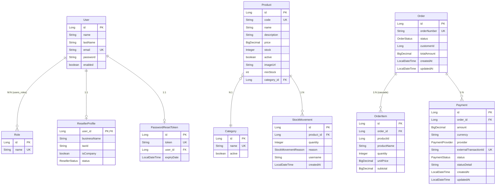

<p align="center">
  
  
  
  
  
  
  
</p>

#  E-Commerce Platform 

> **Plataforma de comercio electrónico full-stack** .
> Combina un backend orientado a eventos con Spring Boot y RabbitMQ, integración de pagos reales con Mercado Pago, y un frontend moderno con Angular 21 y Angular Material.

---

##  Tabla de Contenidos

1. [Descripción y Estado del Proyecto](#1--descripción-y-estado-del-proyecto)
2. [Stack Tecnológico y Librerías](#2--stack-tecnológico-y-librerías)
3. [Arquitectura y Flujos Clave](#3--arquitectura-y-flujos-clave)
4. [Modelo de Datos y Endpoints REST](#4--modelo-de-datos-y-endpoints-rest)
5. [Instrucciones de Despliegue Local](#5--instrucciones-de-despliegue-local)

---

## 1. Descripción y Estado del Proyecto

### ¿Qué es?

Una plataforma e-commerce pensada para la venta de productos genéricos, con panel de administración completo, gestión de inventario con trazabilidad (ledger de movimientos de stock), y procesamiento de pagos en tiempo real mediante Mercado Pago y una arquitectura orientada a eventos con RabbitMQ.

### Módulos Operativos 

| Módulo                       | Descripción                                                                                                     |
| :--------------------------- | :-------------------------------------------------------------------------------------------------------------- |
| **Autenticación & Seguridad** | Registro, login/logout con JWT en cookies `HttpOnly`, recuperación de contraseña vía email (SMTP Gmail), roles `ROLE_ADMIN` / `ROLE_USER`. |
| **Catálogo de Productos**    | CRUD completo con soft-delete/reactivación, búsqueda por nombre/categoría con ordenamiento por precio, imágenes por URL. |
| **Categorías**               | CRUD con soft-delete/reactivación. Relación 1:N con productos.                                                  |
| **Gestión de Usuarios**      | Perfil propio (`/me`), cambio de contraseña, listado y soft-delete por administrador.                            |
| **Órdenes de Compra**        | Checkout con validación de stock y snapshot de precios, generación automática de `orderNumber`, historial de órdenes del cliente, gestión de estados por admin. |
| **Pagos (Mercado Pago)**     | Creación de Preference de pago, recepción de Webhooks con idempotencia, registro de pagos aprobados.            |
| **Inventario (Ledger)**      | Ajustes manuales de stock por admin con registro de motivos (`PURCHASE`, `MANUAL_ADJUSTMENT`, `DAMAGED_GOODS`, `SUPPLIER_REFRESH`), descuento automático por venta (`CUSTOMER_SALE`), alertas por stock mínimo. |
| **Eventos Asíncronos**       | Pipeline `Payment → Order → Inventory` vía RabbitMQ: al aprobarse un pago se actualiza la orden a `PAID` y se descuenta automáticamente el stock. |
| **Manejo Global de Errores** | `@RestControllerAdvice` centralizado (`GlobalExceptionHandler`) con DTO estandarizado `ApiErrorResponse` (timestamp, status, error, message, path, fieldErrors). Maneja `MethodArgumentNotValidException` (400 + detalle por campo), `ResourceNotFoundException` (404), `BusinessException` (400) y `Exception` genérica (500). |
| **Panel Admin (Frontend)**   | Dashboard con sidebar, gestión de usuarios, productos, categorías y órdenes.                                     |
| **Checkout Frontend**        | Páginas de feedback post-pago: success, failure, pending.                                                        |

### Roadmap / En Desarrollo 

| Módulo                            | Estado                                                                                           |
| :-------------------------------- | :----------------------------------------------------------------------------------------------- |
| **Revendedores / Mayoristas**     | Backend: entidades `ResellerProfile`, `ResellerStatus` y endpoint de registro creados. Frontend: formulario de registro de revendedor implementado. Falta: aprobación/rechazo por admin, listas de precios diferenciadas, descuentos por volumen. |
| **Notificaciones por Email**      | Infraestructura de Spring Mail configurada (SMTP Gmail). Actualmente se usa para recuperación de contraseña. Pendiente: notificaciones de cambio de estado de orden, confirmación de compra, alertas de stock. |
| **Tests automatizados**           | Pendiente: tests unitarios de servicios, tests de controladores con MockMvc, tests de componentes Angular. |

---

## 2. Stack Tecnologico y Librerias

### Backend

| Tecnología / Librería                  | Versión                  | Uso                                                            |
| :------------------------------------- | :----------------------- | :------------------------------------------------------------- |
| **Java**                               | 17                       | Lenguaje base del backend                                      |
| **Spring Boot**                        | 3.2.4                    | Framework principal (starter-parent)                           |
| **Spring Web**                         | (managed by Boot 3.2.4)  | REST Controllers, API HTTP                                     |
| **Spring Data JPA**                    | (managed by Boot 3.2.4)  | Persistencia, repositorios, queries                            |
| **Spring Security**                    | (managed by Boot 3.2.4)  | Autenticación, autorización, filtros, CORS                     |
| **Spring Validation**                  | (managed by Boot 3.2.4)  | Validación con anotaciones (`@Valid`, `@NotBlank`, etc.)       |
| **Spring Mail**                        | (managed by Boot 3.2.4)  | Envío de emails (SMTP Gmail) para password reset               |
| **Spring AMQP (RabbitMQ)**             | (managed by Boot 3.2.4)  | Mensajería asíncrona, exchanges, queues, consumers             |
| **Spring Boot Docker Compose**         | (managed by Boot 3.2.4)  | Auto-levantamiento de `compose.yaml` en desarrollo             |
| **JJWT (io.jsonwebtoken)**             | 0.12.5                   | Generación y validación de tokens JWT (api + impl + jackson)   |
| **Mercado Pago SDK**                   | 3.7.0                    | Integración de pagos: Preferences, Webhooks, PaymentClient     |
| **MapStruct**                          | 1.5.5.Final              | Mapeo Entity ↔ DTO en compile-time                             |
| **Lombok**                             | 1.18.30                  | Reducción de boilerplate (`@Data`, `@Builder`, `@RequiredArgsConstructor`) |
| **Lombok-MapStruct Binding**           | 0.2.0                    | Integración entre Lombok y MapStruct                           |
| **MySQL Connector/J**                  | (managed by Boot 3.2.4)  | Driver JDBC para MySQL                                         |
| **Maven Compiler Plugin**              | 3.11.0                   | Compilación con annotation processors                          |

### Frontend

| Tecnología / Librería          | Versión   | Uso                                            |
| :----------------------------- | :-------- | :--------------------------------------------- |
| **Angular**                    | ^21.2.0   | Framework SPA principal                        |
| **Angular Material**           | ^21.2.7   | Componentes UI (tablas, formularios, snackbars) |
| **Angular CDK**                | ^21.2.7   | Utilidades UI de bajo nivel                    |
| **RxJS**                       | ~7.8.0    | Programación reactiva, Observables             |
| **TypeScript**                 | ~5.9.2    | Lenguaje tipado                                |
| **SCSS**                       | —         | Preprocesador CSS                              |
| **Angular CLI**                | ^21.2.6   | Toolchain de desarrollo                        |
| **Vitest**                     | ^4.0.8    | Test runner                                    |
| **Prettier**                   | ^3.8.1    | Formateo de código                             |

### Infraestructura (Docker Compose)

| Servicio      | Imagen                     | Puerto(s)             | Uso                                      |
| :------------ | :------------------------- | :-------------------- | :--------------------------------------- |
| **MySQL**     | `mysql:8.0.33`             | `3306`                | Base de datos relacional                 |
| **RabbitMQ**  | `rabbitmq:3-management`    | `5672` (AMQP), `15672` (Management UI) | Broker de mensajería asíncrona |

---

## 3. Arquitectura y Flujos Clave

### 3.1 Arquitectura General

```
┌─────────────────┐         ┌──────────────────────────────┐
│   Angular SPA   │◄──────► │    Spring Boot REST API       │
│   (port 4200)   │  HTTP   │       (port 8080)             │
│                 │  Proxy  │                               │
│  • Home/Catalog │  /api/* │  ┌──────────┐ ┌────────────┐ │
│  • Admin Panel  │         │  │ Security │ │  Features  │ │
│  • Checkout     │         │  │  (JWT)   │ │  Modules   │ │
│  • Profile      │         │  └──────────┘ └────────────┘ │
└─────────────────┘         └──────────┬───────────────────┘
                                       │
                            ┌──────────┼──────────┐
                            ▼          ▼          ▼
                       ┌────────┐ ┌────────┐ ┌─────────────┐
                       │ MySQL  │ │RabbitMQ│ │ Mercado Pago│
                       │ 8.0.33 │ │  3-mgt │ │   API       │
                       └────────┘ └────────┘ └─────────────┘
```

La comunicación frontend → backend se realiza a través de un **reverse proxy** configurado en `proxy.conf.json` que redirige todas las peticiones `/api/*` al backend en `localhost:8080`.

### 3.2 Arquitectura Orientada a Eventos con RabbitMQ

El sistema implementa un **pipeline de eventos asíncronos** que desacopla completamente los módulos de Payment, Order e Inventory:

```
                          ┌──────────────────────────────────────────────────────┐
                          │              FLUJO DE EVENTOS COMPLETO              │
                          └──────────────────────────────────────────────────────┘

 Mercado Pago                 Payment Module              RabbitMQ                    Order Module                RabbitMQ                  Inventory Module
 ───────────                  ──────────────              ────────                    ────────────                ────────                  ────────────────

 ┌──────────┐  Webhook POST   ┌─────────────────────┐     ┌──────────────────┐       ┌────────────────────────┐  ┌──────────────────┐      ┌──────────────────────┐
 │          │────────────────►│PaymentProcessingService│──►│ payment.exchange │──────►│ PaymentEventConsumer   │─►│  order.exchange  │─────►│ OrderInventoryConsumer│
 │ MP API   │                 │                     │     │                  │       │                        │  │                  │      │                      │
 │          │                 │ 1. Idempotencia     │     │ Routing Key:     │       │ 1. Actualiza estado    │  │ Routing Key:     │      │ 1. Descuenta stock   │
 └──────────┘                 │ 2. Consulta MP SDK  │     │ payment.approved │       │    Order → PAID        │  │ order.paid       │      │    de cada producto   │
                              │ 3. Guarda Payment   │     │                  │       │ 2. Publica             │  │                  │      │ 2. Registra           │
                              │ 4. Publica evento   │     │ Queue:           │       │    OrderPaidEvent      │  │ Queue:           │      │    StockMovement      │
                              └─────────────────────┘     │ order.payment.   │       └────────────────────────┘  │ inventory.order. │      │    (CUSTOMER_SALE)    │
                                                          │ approved.queue   │                                   │ paid.queue       │      │ 3. Alerta si stock   │
                                                          └──────────────────┘                                   └──────────────────┘      │    < minStock         │
                                                                                                                                           └──────────────────────┘
```

#### Detalle de la Infraestructura RabbitMQ

| Componente         | Nombre                          | Tipo           | Descripción                                                |
| :----------------- | :------------------------------ | :------------- | :--------------------------------------------------------- |
| **Exchange #1**    | `payment.exchange`              | Topic Exchange | Recibe eventos de pagos aprobados                          |
| **Exchange #2**    | `order.exchange`                | Topic Exchange | Recibe eventos de órdenes pagadas                          |
| **Queue #1**       | `order.payment.approved.queue`  | Durable Queue  | El módulo Order escucha pagos aprobados                    |
| **Queue #2**       | `inventory.order.paid.queue`    | Durable Queue  | El módulo Inventory escucha órdenes pagadas                |
| **Routing Key #1** | `payment.approved`              | —              | Vincula `payment.exchange` → `order.payment.approved.queue`|
| **Routing Key #2** | `order.paid`                    | —              | Vincula `order.exchange` → `inventory.order.paid.queue`    |

#### Eventos (Records Java)

| Evento                  | Campos                                                           | Productor                    | Consumidor                |
| :---------------------- | :--------------------------------------------------------------- | :--------------------------- | :------------------------ |
| `PaymentApprovedEvent`  | `paymentId`, `orderId`, `externalTransactionId`, `amount`, `timestamp` | `PaymentProcessingService`   | `PaymentEventConsumer`    |
| `OrderPaidEvent`        | `orderId`, `orderNumber`, `customerId`, `items[]`, `timestamp`   | `PaymentEventConsumer`       | `OrderInventoryConsumer`  |

Todos los payloads se serializan/deserializan automáticamente con `Jackson2JsonMessageConverter`.

### 3.3 Integración de Pagos con Mercado Pago

El flujo de pago end-to-end funciona así:

1. **Checkout** (`OrderService.checkout()`): Se crea la `Order` en estado `PENDING_PAYMENT`, se valida stock y se genera un snapshot de precios.
2. **Preference** (`MercadoPagoPreferenceService`): Se crea una Preference en la API de Mercado Pago con los items de la orden, `externalReference = orderId`, URLs de retorno (`success`, `failure`, `pending`) y `notificationUrl` para el webhook.
3. **Redirección**: El frontend recibe el `sandboxInitPoint` y redirige al usuario al checkout de Mercado Pago.
4. **Webhook** (`PaymentWebhookController`): Mercado Pago envía un `POST /api/payments/webhook` con `type=payment` y el `data.id` del pago.
5. **Procesamiento** (`PaymentProcessingService`):
   - **Idempotencia**: Verifica si el `externalTransactionId` ya existe en la DB.
   - **Verificación**: Consulta el estado real del pago vía el SDK de MP (`PaymentClient.get()`).
   - **Persistencia**: Si está `approved`, crea la entidad `Payment` y la guarda.
   - **Evento**: Publica `PaymentApprovedEvent` al exchange de RabbitMQ, disparando el pipeline asíncrono.
6. **Feedback**: El usuario es redirigido a `/checkout/success`, `/checkout/failure` o `/checkout/pending` según el resultado.

> **Entorno de pruebas**: Se utiliza `sandboxInitPoint` (modo sandbox de Mercado Pago) en la configuracion actual. Ademas, existe un `TestPaymentSimulationController` (solo perfiles `dev`/`test`) que permite simular aprobaciones de pago sin pasar por MP.

### 3.4 Seguridad — JWT + Cookies + Roles

```
                    Request HTTP
                         │
                         ▼
              ┌──────────────────┐
              │  AuthTokenFilter │  (extends OncePerRequestFilter)
              │                  │
              │ 1. Extrae JWT    │──► Cookie: "ecommerce-token"
              │    de la Cookie  │
              │ 2. Valida firma  │──► HMAC-SHA con jwtSecret
              │    y expiración  │
              │ 3. Extrae        │──► username (subject del JWT)
              │    username      │
              │ 4. Carga         │──► UserDetailsServiceImpl → UserRepository
              │    UserDetails   │
              │ 5. Setea en      │──► SecurityContextHolder
              │    SecurityCtx   │
              └────────┬─────────┘
                       │
                       ▼
              ┌──────────────────┐
              │  SecurityFilter  │
              │     Chain        │
              │                  │
              │ • Stateless      │  (SessionCreationPolicy.STATELESS)
              │ • CSRF disabled  │
              │ • CORS config    │  (localhost:4200)
              │ • @PreAuthorize  │  (hasRole('ADMIN'), isAuthenticated())
              └──────────────────┘
```

**Detalle de la configuración de seguridad:**

- **Sesiones**: `STATELESS` — no se almacena estado en el servidor.
- **Contraseñas**: Hasheadas con `BCryptPasswordEncoder`.
- **Token JWT**: Generado con `JJWT 0.12.5`, almacenado en cookie `HttpOnly`, `Secure`, `SameSite=Lax`.
- **Expiración**: Configurable vía `JWT_EXPIRATION_MS` (default: 24 horas / 86400000 ms).
- **Roles**: `ROLE_ADMIN` y `ROLE_USER`, asignados vía tabla intermedia `users_roles`.
- **Protección de endpoints**: Combinación de reglas en `SecurityFilterChain` y anotaciones `@PreAuthorize` a nivel de método.
- **Recuperación de contraseña**: Token de reset con expiración, enviado por email vía SMTP.

**Endpoints públicos (sin autenticación):**

| Patrón                           | Descripción                      |
| :------------------------------- | :------------------------------- |
| `POST /api/auth/**`             | Login, registro, logout, password reset |
| `GET /api/products/**`          | Catálogo de productos (lectura)  |
| `GET /api/categories/**`        | Listado de categorías (lectura)  |
| `POST /api/v1/resellers/register` | Registro de revendedores       |
| `POST /api/payments/webhook/**` | Webhook de Mercado Pago          |

---

## 4. Modelo de Datos y Endpoints REST

### 4.1 Diagrama de Entidades



### 4.2 Enumeraciones

| Enum                    | Valores                                                                      |
| :---------------------- | :--------------------------------------------------------------------------- |
| `OrderStatus`           | `PENDING_PAYMENT`, `PAID`, `PROCESSING`, `DELIVERED`, `CANCELLED`            |
| `PaymentStatus`         | `PENDING`, `APPROVED`, `REJECTED`, `REFUNDED`                               |
| `PaymentProvider`       | `MERCADO_PAGO`, `STRIPE`, `CASH`                                            |
| `StockMovementReason`   | `PURCHASE`, `MANUAL_ADJUSTMENT`, `DAMAGED_GOODS`, `SUPPLIER_REFRESH`, `CUSTOMER_SALE`, `RESELLER_SALE`, `SALE_CANCELED` |
| `ResellerStatus`        | `PENDING`, `APPROVED`, `REJECTED`                                            |

### 4.3 Endpoints REST — Total: **30 endpoints implementados**

#### Auth (`/api/auth`) -- 5 endpoints

| Método | Ruta                      | Acceso   | Descripción                        |
| :----- | :------------------------ | :------- | :--------------------------------- |
| POST   | `/api/auth/signup`        | Público  | Registro de nuevo usuario          |
| POST   | `/api/auth/signin`        | Público  | Login (devuelve JWT en cookie)     |
| POST   | `/api/auth/signout`       | Público  | Logout (limpia cookie)             |
| POST   | `/api/auth/forgot-password` | Público | Solicitar reset de contraseña      |
| POST   | `/api/auth/reset-password`  | Público | Ejecutar reset con token           |

#### Products (`/api/products`) -- 6 endpoints

| Método | Ruta                           | Acceso     | Descripción                             |
| :----- | :----------------------------- | :--------- | :-------------------------------------- |
| GET    | `/api/products`                | Público    | Listar todos los productos              |
| GET    | `/api/products/{id}`           | Público    | Obtener producto por ID                 |
| GET    | `/api/products/search`         | Público    | Buscar por query, categoría y precio    |
| POST   | `/api/products`                | ADMIN      | Crear nuevo producto                    |
| PUT    | `/api/products/{id}`           | ADMIN      | Actualizar producto                     |
| DELETE | `/api/products/{id}`           | ADMIN      | Soft-delete de producto                 |
| PATCH  | `/api/products/{id}/activate`  | ADMIN      | Reactivar producto                      |

#### Categories (`/api/categories`) -- 6 endpoints

| Método | Ruta                              | Acceso     | Descripción                          |
| :----- | :-------------------------------- | :--------- | :----------------------------------- |
| GET    | `/api/categories`                 | Público    | Listar todas las categorías          |
| GET    | `/api/categories/{id}`            | Público    | Obtener categoría por ID             |
| POST   | `/api/categories`                 | ADMIN      | Crear categoría                      |
| PUT    | `/api/categories/{id}`            | ADMIN      | Actualizar categoría                 |
| DELETE | `/api/categories/{id}`            | ADMIN      | Soft-delete de categoría             |
| PATCH  | `/api/categories/{id}/activate`   | ADMIN      | Reactivar categoría                  |

#### Users (`/api/users`) -- 6 endpoints

| Método | Ruta                    | Acceso                | Descripción                            |
| :----- | :---------------------- | :-------------------- | :------------------------------------- |
| GET    | `/api/users/me`         | Autenticado           | Obtener perfil propio                  |
| GET    | `/api/users`            | ADMIN                 | Listar todos los usuarios activos      |
| GET    | `/api/users/{id}`       | ADMIN o propio        | Obtener usuario por ID                 |
| PUT    | `/api/users/{id}`       | ADMIN o propio        | Actualizar usuario                     |
| PUT    | `/api/users/me`         | Autenticado           | Actualizar perfil propio               |
| DELETE | `/api/users/{id}`       | ADMIN                 | Eliminar usuario                       |
| PATCH  | `/api/users/me/password`| Autenticado           | Cambiar contraseña propia              |

#### Orders (`/api/orders`) -- 5 endpoints

| Método | Ruta                        | Acceso       | Descripción                           |
| :----- | :-------------------------- | :----------- | :------------------------------------ |
| POST   | `/api/orders/checkout`      | Autenticado  | Crear orden y obtener link de pago MP |
| GET    | `/api/orders/{id}`          | Autenticado  | Obtener orden por ID                  |
| GET    | `/api/orders/my-orders`     | Autenticado  | Listar órdenes del usuario            |
| GET    | `/api/orders`               | ADMIN        | Listar todas las órdenes              |
| PATCH  | `/api/orders/{id}/status`   | ADMIN        | Actualizar estado de la orden         |

#### Payments (`/api/payments`) -- 2 endpoints

| Método | Ruta                                             | Acceso    | Descripción                                   |
| :----- | :----------------------------------------------- | :-------- | :-------------------------------------------- |
| POST   | `/api/payments/webhook`                          | Público   | Webhook de notificaciones de Mercado Pago      |
| POST   | `/api/payments/test/simulate-approval/{orderId}` | Dev/Test  | Simular aprobación de pago (solo perfil dev)   |

#### Inventory (`/api/inventory`) -- 1 endpoint

| Método | Ruta                       | Acceso | Descripción                           |
| :----- | :------------------------- | :----- | :------------------------------------ |
| POST   | `/api/inventory/adjustment` | ADMIN  | Ajuste manual de stock con motivo     |

#### Resellers (`/api/v1/resellers`) -- 1 endpoint

| Método | Ruta                           | Acceso  | Descripción                        |
| :----- | :----------------------------- | :------ | :--------------------------------- |
| POST   | `/api/v1/resellers/register`   | Público | Solicitud de registro de revendedor|

---

## 5. Instrucciones de Despliegue Local

### Prerequisitos

- **Java 17** (JDK)
- **Maven** 3.9+ (o usar el wrapper `./mvnw` incluido)
- **Node.js** 22+ y **npm** 11+
- **Docker** y **Docker Compose**
- Cuenta de **Mercado Pago** (para obtener el Access Token de sandbox)
- *(Opcional)* **ngrok** para exponer el webhook de MP en desarrollo

### Paso 1 — Clonar el repositorio

```bash
git clone <url-del-repositorio>
cd pp2
```

### Paso 2 — Configurar variables de entorno del Backend

```bash
cd ecommerce-api
cp .env.example .env
```

Editar `.env` con tus valores reales:

```env
# Base de datos MySQL
DB_HOST=localhost
DB_PORT=3306
DB_NAME=ppdb
DB_USERNAME=root
DB_PASSWORD=tu_password_de_mysql

# Correo (Gmail SMTP — requiere App Password de 16 caracteres)
MAIL_HOST=smtp.gmail.com
MAIL_PORT=587
MAIL_USERNAME=tu_correo@gmail.com
MAIL_PASSWORD=tu_app_password_de_16_caracteres

# JWT
JWT_SECRET=tu_clave_secreta_super_larga_y_segura_para_el_token_jwt
JWT_EXPIRATION_MS=86400000
JWT_COOKIE_NAME=ecommerce-token

# RabbitMQ
RABBITMQ_USER=guest
RABBITMQ_PASSWORD=guest

# Mercado Pago
MP_ACCESS_TOKEN=tu_access_token_de_sandbox
MP_WEBHOOK_URL=https://tu-subdominio.ngrok-free.dev/api/payments/webhook
```

### Paso 3 — Levantar la infraestructura con Docker Compose

```bash
cd ecommerce-api
docker compose up -d
```

Esto levanta:
- **MySQL 8.0.33** en `localhost:3306` (DB: `ppdb`)
- **RabbitMQ 3-management** en `localhost:5672` (AMQP) y `localhost:15672` (Management UI, user: `guest`/`guest`)

Verificar que los contenedores están corriendo:

```bash
docker ps
# Deberías ver: mysql-pp2 y rabbitmq-pp2
```

### Paso 4 — Levantar el Backend

```bash
cd ecommerce-api
./mvnw spring-boot:run
```

> Spring Boot detectará automáticamente el `compose.yaml` gracias a `spring-boot-docker-compose`. Si ya levantaste los contenedores manualmente, el auto-start estará deshabilitado.
>
> El backend arranca en `http://localhost:8080` con perfil `dev` por defecto (`ddl-auto: update` crea las tablas automáticamente).
>
> Al iniciar, el `DataInitializer` crea automáticamente:
> - Roles: `ROLE_ADMIN`, `ROLE_USER`
> - Admin: `admin@ecommerce.com` / `admin123`
> - Usuarios de prueba: `mateo@test.com`, `pepe@test.com`, `jose@test.com` / `user123`
> - Categoría "Hardware" con productos de ejemplo

### Paso 5 — Levantar el Frontend

```bash
cd frontend
npm install
npm start
```

El frontend arranca en `https://localhost:4200` (con SSL por defecto de Angular 21). El proxy inverso en `proxy.conf.json` redirige `/api/*` → `http://localhost:8080`.

### Paso 6 — *(Opcional)* Configurar ngrok para Webhooks de Mercado Pago

```bash
ngrok http 8080
```

Copiar la URL generada (ej: `https://abc123.ngrok-free.dev`) y configurarla en `.env`:

```env
MP_WEBHOOK_URL=https://abc123.ngrok-free.dev/api/payments/webhook
```

Reiniciar el backend para que tome el nuevo valor.

---

<p align="center">
  <strong>Desarrollado por Mateo Cracco</strong> — Práctica Profesionalizante II, ISSD
</p>
